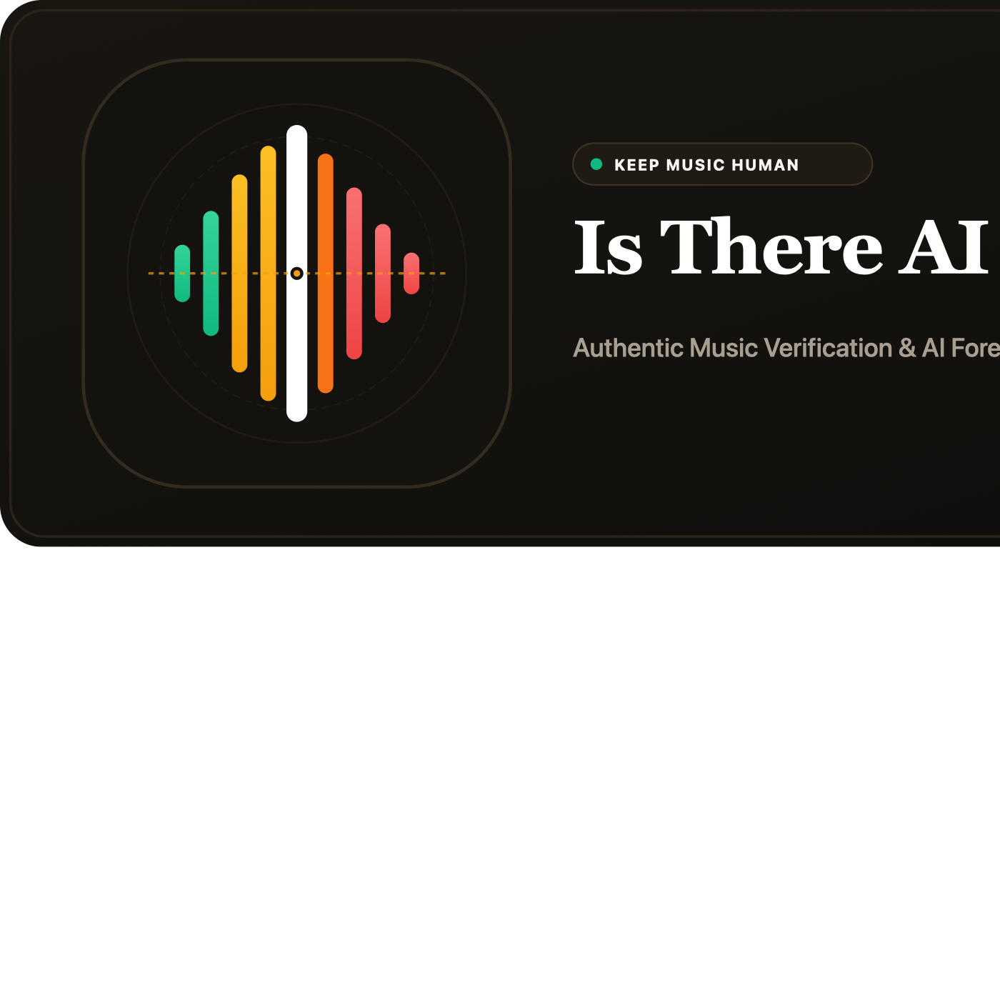

<p align="center">
  
</p>

# 🎵 Is There AI In My Playlist?

A fast, transparent web application that scans playlists from **Spotify**, **Apple Music**, and **YouTube / YouTube Music** to detect AI-generated songs and stream-farm anomalies.

🌐 **Live Website:** [https://isthereaiinmyplaylist.tech](https://isthereaiinmyplaylist.tech)

---

## ✨ Features

1. **Multi-Platform Support (No API Keys Required for Public Scans):**
   - **Spotify** (`open.spotify.com/playlist/...`, `open.spotify.com/track/...`, `open.spotify.com/album/...`)
   - **Apple Music** (`music.apple.com/.../playlist/...`, album, song)
   - **YouTube & YouTube Music** (`music.youtube.com/playlist?list=...`, `youtube.com/playlist?list=...`, single video)
2. **Personal Library Integrations (Spotify & YouTube Music):**
   - **Spotify:** Sign in via Spotify OAuth 2.0 to browse and scan personal or private playlists directly. When AI tracks are detected, generate a clean `[AI-Free]` human-only playlist directly in your account with 1 click.
   - **YouTube Music:** Sign in via Google / YouTube OAuth 2.0 to browse personal, unlisted, and private YouTube playlists and scan them directly.
3. **4-Layer AI Detection Engine:**
   - **Keywords & Generator Signatures:** Detects traces of *Suno, Udio, RVC v2, Kits.ai, Boomy, Riffusion, AIVA*, and metadata flags like *AI Cover / AI Generated*.
   - **Known AI Artists Database & Community Reporting:** Includes 10,000+ confirmed AI and "ghost" projects (*The Velvet Sundown, Breezeway Cocktail, Endel, AIVA, Ghostwriter977*) with real-time community reporting.
   - **Artist History & Release Velocity Verification:** Evaluates earliest release year (pre-2023 discography protection safeguard), fanbase size, singles ratio, and catalog cadence.
   - **Audio Preview & Duration Telemetry:** Measures duration anomalies and spectral byte characteristics.
4. **Standalone Compliance & Privacy Pages:**
   - [Privacy Policy](/privacy) (GDPR & Google Limited Use Policy compliant, cookieless by default, zero password storage)
   - [Terms of Service](/terms) (Heuristic forensic notices & acceptable use terms)
   - [Legal & Trademarks](/legal) (Nominative fair use disclosures and non-affiliation statements)

## 🚀 Getting Started

```bash
cd ~/Desktop/Prg/isthereaiinmyplaylist
npm start
```

Open **[http://localhost:3000](http://localhost:3000)** in your browser.

## ⚖️ Legal, Disclaimers & Licensing

- **Code License:** [MIT License](LICENSE) © 2026 Oliver Tobiášek (full breakdown in [LICENSES.md](LICENSES.md)).
- **Trademarks:** Spotify®, Apple Music®, YouTube™, Google®, Deezer®, and MusicBrainz® are trademarks or registered trademarks of their respective owners. Their use on this website is strictly for nominative descriptive fair use to identify public playlist compatibility. This project is an independent research forensics tool not affiliated with or endorsed by any platform.
- **Forensics Heuristics Disclaimer:** AI risk metrics and anomaly flags are heuristic estimates provided for informational and educational research. They do not constitute a legal certification of non-human authorship or copyright status.
- **GDPR & Privacy:** Cookieless by default. Secure OAuth 2.0 login with Spotify and Google without storing credentials. All web fonts (Inter, JetBrains Mono, Space Grotesk) are self-hosted locally without external CDN requests.
- **Full Legal Breakdown:** See **[LICENSES.md](LICENSES.md)** for complete details, API attributions, and artist dispute/takedown processes.
